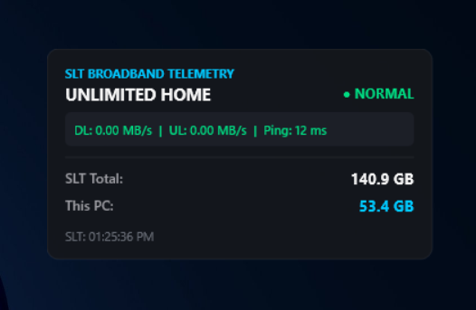
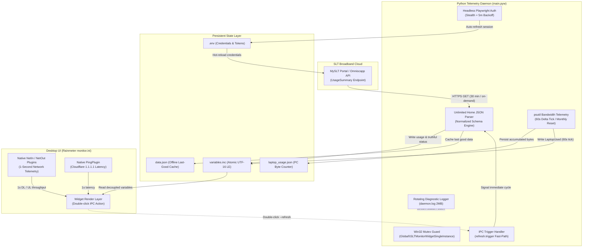
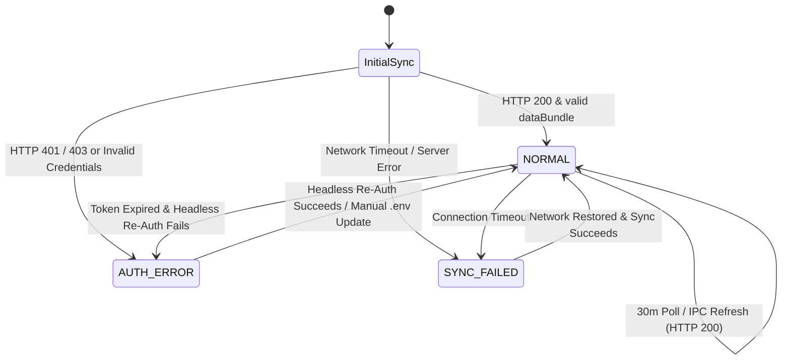

# SLT Fiber Telemetry Monitor

A production-grade, background telemetry desktop widget for **SLT Broadband (MySLT Unlimited Fiber)** and local workstation network tracking, rendered as an elegant, native Rainmeter skin.

The system decouples real-time local network telemetry from external ISP billing cycles: a lightweight, windowless Python daemon manages authenticated SLT portal syncs and monthly hardware bandwidth accounting via `psutil`, while native Rainmeter C++ plugins drive 1-second network throughput and Cloudflare latency monitoring with near-zero CPU footprint.

[](https://github.com/janithush/Myslt_meter/releases/tag/v2.0.0)
[](https://www.python.org/)
[](https://www.rainmeter.net/)
[](https://playwright.dev/)
[](https://www.microsoft.com/windows)
[](LICENSE)

---



---

## Table of Contents

- [System Architecture](#system-architecture)
- [Key Features](#key-features)
- [Separation of Concerns & Decoupled Loops](#separation-of-concerns--decoupled-loops)
- [Prerequisites & Dependencies](#prerequisites--dependencies)
- [Installation & Setup](#installation--setup)
- [Configuration (.env)](#configuration-env)
- [Windows Startup Automation](#windows-startup-automation)
- [`variables.inc` Interface Contract](#variablesinc-interface-contract)
- [Truthful UI State Engine](#truthful-ui-state-engine)
- [Troubleshooting & Diagnostics](#troubleshooting--diagnostics)
- [Changelog (v2.0.0 vs v1.0.0)](#changelog-v200-vs-v100)
- [Security Practices](#security-practices)
- [License](#license)

---

## System Architecture

The architecture enforces a strict boundary between real-time local telemetry, external ISP billing synchronization, and desktop UI rendering.



---

## Key Features

- **Unlimited Home Package Engine**: Dedicated JSON parser extracting `dataBundle.my_package_summary.used` for SLT Unlimited packages, with robust fallback routines for standard quota packages (`usageDetails`).
- **Local Hardware Telemetry (`psutil`)**: Tracks byte deltas across reboots and network switches, persisting machine consumption to `laptop_usage.json` every 60 seconds with automatic monthly reset on the 1st of each month.
- **Decoupled Timestamp Architecture**: Strict separation between `SLTUpdatedAt` (external ISP billing sync timestamp) and `LocalUpdatedAt` (workstation telemetry tick), preventing misleading "fake fresh" timestamps.
- **Truthful UI State Reporting**: Zero fake success. When sessions expire (`HTTP 401/403`) or networks fail, the skin displays alert badges (`AUTH_ERROR` / `SYNC_FAILED`) in high-contrast red (`#ColorWarn#`), dims stale metrics, and displays `[!] failed` without overwriting historical values.
- **Native Rainmeter Performance**: Real-time download/upload speed (`[MeasureNetIn]`, `[MeasureNetOut]`) and Cloudflare `1.1.1.1` ping (`PingPlugin`) execute directly via native Rainmeter C++ plugins at 1000ms intervals. All static text meters sleep at `UpdateDivider=-1` for zero idle CPU usage.
- **Resilient Silent Headless Authentication**: Background Playwright Chromium automation equipped with `playwright-stealth` evasions (`--disable-blink-features=AutomationControlled`), API request interception, localStorage/sessionStorage fallback sweeps, bounded 35s timeouts, guaranteed context cleanup in `finally`, and a 5-minute failure backoff.
- **Win32 Mutex & Fast-Path IPC**: Guaranteed single instance using named mutex `Global\SLTMonitorWidgetSingleInstance`. Widget double-clicks signal the active daemon via `refresh.trigger` in sub-100ms. If no daemon is running, the process auto-promotes to become the background daemon.
- **Silent Windows Startup Automation**: `launch_daemon.vbs` detects virtual environment interpreters (`.venv\Scripts\pythonw.exe`) and launches `main.pyw` completely hidden with zero console flicker on Windows logon.
- **Persistent Diagnostic Logging**: Production-grade `RotatingFileHandler` writing structured logs to `daemon.log` (2MB limit, 1 backup) with automatic redirection for `sys.stdout`/`sys.stderr` and unhandled exceptions.

---

## Separation of Concerns & Decoupled Loops

The system operates across three asynchronous rhythms:

| Loop | Owner | Interval | Description |
|---|---|---|---|
| **Real-time Local Metrics** | Rainmeter (`monitor.ini`) | 1,000 ms | Native C++ measurement of incoming bytes, outgoing bytes, and ICMP ping to Cloudflare `1.1.1.1`. Zero Python overhead. |
| **Local PC Consumption** | Python Daemon (`psutil`) | 60 sec | Reads `psutil.net_io_counters()`, calculates byte deltas, updates `laptop_usage.json`, and updates `LaptopUsed` in `variables.inc`. |
| **ISP Portal Sync** | Python Daemon (`requests` / Playwright) | 30 min / IPC | Queries SLT Omniscapp API. If unauthenticated, triggers stealth headless Playwright refresh, updates `.env`, writes `variables.inc`, and nudges Rainmeter. |
| **Fast-Path Manual Refresh** | Rainmeter UI → IPC | On Demand | Double-clicking the widget creates `refresh.trigger`. The running daemon wakes within 1 second, executes a fresh sync, and reloads the skin. |

---

## Prerequisites & Dependencies

### System Requirements
- **Operating System**: Windows 10 / 11 (64-bit)
- **Rainmeter**: Version 4.5 or newer ([Download Rainmeter](https://www.rainmeter.net/))
- **Python**: Version 3.10 or newer (tested on Python 3.12 / 3.14)

### Python Dependencies
Installed automatically via `pyproject.toml` or `pip`:
- `requests >= 2.34.2`: High-performance HTTP client for SLT API calls.
- `psutil >= 7.0.0`: Cross-platform process and system monitoring for network hardware counters.
- `playwright >= 1.40.0`: Headless browser automation for session generation.
- `playwright-stealth >= 2.0.0`: Chromium anti-bot evasion framework.

---

## Installation & Setup

### 1. Clone the Repository
Clone the project into your preferred development workspace:
```powershell
git clone https://github.com/janithush/Myslt_meter.git D:\Projects\Myslt_meter
cd D:\Projects\Myslt_meter
```

### 2. Configure Python Environment
Create an isolated virtual environment and install the required dependencies:
```powershell
python -m venv .venv
.\.venv\Scripts\Activate.ps1
python -m pip install --upgrade pip
pip install requests psutil playwright playwright-stealth
```

Install the headless Chromium binary required by Playwright:
```powershell
playwright install chromium
```

### 3. Deploy Rainmeter Skin
Link or copy the skin files to your Rainmeter skins directory:
```powershell
$SkinTarget = "$env:USERPROFILE\Documents\Rainmeter\Skins\SLTMonitor"
New-Item -ItemType Directory -Force -Path $SkinTarget

# Copy skin configuration
Copy-Item "monitor.ini" -Destination "$SkinTarget\monitor.ini" -Force
```

---

## Configuration (.env)

Initialize your local configuration by copying `.env.example`:
```powershell
Copy-Item .env.example .env
notepad .env
```

Configure your credentials and account properties:
```ini
# Required: Broadband account identifier
SLT_SUBSCRIBER_ID=94XXXXXXXXX

# Required for automated headless session refresh:
SLT_USERNAME=your_myslt_username_or_email
SLT_PASSWORD=your_myslt_password

# Gateway identifier (default pre-configured)
SLT_X_IBM_CLIENT_ID=b7402e9d66808f762ccedbe42c20668e

# Managed automatically by Playwright (can also be manually populated from DevTools):
SLT_AUTHORIZATION=bearer YOUR_TOKEN_HERE
SLT_COOKIE=incap_ses_...; visid_incap_...
```

> [!NOTE]
> `main.pyw` hot-reloads `.env` on every cycle. If you manually paste fresh tokens or cookies from your browser's Developer Tools (Network tab → `UsageSummary`), the daemon applies them immediately without needing a restart.

---

## Windows Startup Automation

To ensure continuous, silent telemetry without manual intervention, a dedicated VBS wrapper (`launch_daemon.vbs`) is provided:

```vbs
Set WshShell = CreateObject("WScript.Shell")
Set FSO = CreateObject("Scripting.FileSystemObject")
scriptDir = FSO.GetParentFolderName(WScript.ScriptFullName)
venvPythonw = scriptDir & "\.venv\Scripts\pythonw.exe"
If FSO.FileExists(venvPythonw) Then
    cmd = """" & venvPythonw & """ """ & scriptDir & "\main.pyw"""
Else
    cmd = "pythonw.exe """ & scriptDir & "\main.pyw"""
End If
WshShell.CurrentDirectory = scriptDir
WshShell.Run cmd, 0, False
```

### Creating the Startup Shortcut
Create a shortcut to `launch_daemon.vbs` in the Windows Startup directory:

```powershell
$WshShell = New-Object -ComObject WScript.Shell
$StartupFolder = [System.Environment]::GetFolderPath('Startup')
$Shortcut = $WshShell.CreateShortcut("$StartupFolder\SLTMonitor.lnk")
$Shortcut.TargetPath = "wscript.exe"
$Shortcut.Arguments = "`"D:\Projects\Myslt_meter\launch_daemon.vbs`""
$Shortcut.WorkingDirectory = "D:\Projects\Myslt_meter"
$Shortcut.WindowStyle = 7  # Minimized / Hidden
$Shortcut.Save()
```

The daemon will now launch silently in the background on every Windows login with zero terminal windows or taskbar icons.

---

## `variables.inc` Interface Contract

The daemon communicates with Rainmeter by atomically generating `variables.inc` using native `UTF-16 LE with BOM` encoding:

```ini
[Variables]
PackageName=UNLIMITED HOME
SLTTotalUsed=61.0 GB
LaptopUsed=9.2 GB
Status=NORMAL
Unit=GB
SLTUpdatedAt=03:38:55 PM
UpdatedAt=03:38:55 PM
LocalUpdatedAt=04:07:57 PM
FetchStatus=success
```

### Field Definitions

| Variable | Description | Source |
|---|---|---|
| `PackageName` | SLT subscription plan name (e.g. `UNLIMITED HOME`) | Portal API |
| `SLTTotalUsed` | Total broadband consumption recorded by SLT | Portal API (`my_package_summary.used`) |
| `LaptopUsed` | Accumulated workstation consumption for current calendar month | Local `psutil` delta tracking |
| `Status` | Operational state: `NORMAL`, `THROTTLED`, `AUTH_ERROR`, or `SYNC_FAILED` | Telemetry Engine |
| `Unit` | Data volume measurement unit (`GB`) | Portal API |
| `SLTUpdatedAt` | Timestamp of the last successful SLT portal fetch | Portal API / Sync clock |
| `UpdatedAt` | Backward compatibility alias for `SLTUpdatedAt` | Portal API / Sync clock |
| `LocalUpdatedAt` | Timestamp of the last local hardware tick (60s loop) | Local workstation clock |
| `FetchStatus` | Current fetch state: `success` or `failed` | Telemetry Engine |

---

## Truthful UI State Engine

Unlike earlier prototypes that reported "success" even during connection dropouts, v2.0 enforces absolute telemetry integrity:



### Visual Indicators in `monitor.ini`

- **Normal State (`● NORMAL`)**: Displayed in vibrant emerald green (`#ColorAccent# = 0,220,130,255`). Indicates healthy synchronization.
- **Authentication Failure (`● AUTH_ERROR`)**: Displayed in warning red (`#ColorWarn# = 255,90,90,255`). Appears when tokens expire and headless re-authentication is in cooldown or failed. Retains last-known usage metrics while showing `[!] failed`.
- **Sync Failure (`● SYNC_FAILED`)**: Displayed in warning red (`#ColorWarn#`). Appears during ISP API timeouts, DNS outages, or connection drops. Stale values are dimmed to `#ColorDim#` to alert the user.
- **Throttling Alert (`● THROTTLED`)**: Displayed in warning red (`#ColorWarn#`) when the ISP flags policy throttling.

---

## Troubleshooting & Diagnostics

### Reading Diagnostic Logs (`daemon.log`)
The daemon maintains a 2MB rotating log (`daemon.log`) capturing detailed lifecycle events, authentication sequences, and API responses:

```powershell
# View recent daemon events in real-time
Get-Content -Path "D:\Projects\Myslt_meter\daemon.log" -Tail 30 -Wait
```

**Representative log entries:**
```text
[2026-11-09 13:08:51] [WARNING] Portal response indicated session expired/blocked (HTTP None). Triggering re-authentication...
[2026-11-09 13:08:51] [INFO] Launching silent headless browser for session refresh...
[2026-11-09 13:09:32] [INFO] Credentials submitted on login form.
[2026-11-09 13:09:38] [INFO] Captured fresh Authorization header from API request.
[2026-11-09 13:09:41] [INFO] .env updated with fresh session.
[2026-11-09 13:09:42] [INFO] Synced: UNLIMITED HOME | SLT Used: 60.0 GB | Laptop: 8.6 GB | Status: NORMAL
```

### Manual Fast-Path Refresh
- **Desktop UI**: Double-click anywhere on the widget card to trigger an immediate portal sync.
- **Command Line**: Execute the refresh argument:
  ```powershell
  .\.venv\Scripts\pythonw.exe main.pyw --refresh
  ```

### Managing Daemon Processes
To verify whether the background daemon is active:
```powershell
Get-Process pythonw | Where-Object { $_.Path -like "*Myslt_meter*" }
```

To stop and restart the daemon:
```powershell
# Terminate existing daemon instances
Get-Process pythonw | Where-Object { $_.Path -like "*Myslt_meter*" } | Stop-Process -Force

# Launch daemon cleanly via VBS
wscript.exe "D:\Projects\Myslt_meter\launch_daemon.vbs"
```

---

## Changelog (v2.0.0 vs v1.0.0)

| Architectural Area | Legacy Prototype (v1.0.0) | Production Telemetry Engine (v2.0.0) |
|---|---|---|
| **ISP Package Schema** | Hardcoded legacy quota keys (`limit`, `remaining`). Broke on unlimited fiber plans. | Dedicated Unlimited Home parser extracting `my_package_summary.used` with fallback logic. |
| **Local Telemetry** | None. Only displayed ISP reported totals. | Built-in `psutil` engine tracking monthly workstation byte deltas in `laptop_usage.json`. |
| **Timestamp Fidelity** | Single timestamp updated locally, causing false impression of portal freshness. | Decoupled timestamps (`SLTUpdatedAt` for ISP sync vs `LocalUpdatedAt` for hardware ticks). |
| **State Integrity** | Forced fake "success" fallback during outages. Stale data was disguised as fresh. | Truthful state reporting: emits `AUTH_ERROR` / `SYNC_FAILED`, red warning badge, and dimmed meters. |
| **Real-time Bandwidth** | None, or attempted through heavy Python loops. | Native Rainmeter C++ `[MeasureNetIn]`, `[MeasureNetOut]`, and `PingPlugin` (Cloudflare `1.1.1.1`). |
| **Browser Automation** | Basic Playwright without backoff; prone to anti-bot detection and process leaks. | Stealth evasions (`playwright-stealth`), 35s bounded timeouts, 5-minute cooldown, and clean teardown. |
| **Process Model** | Manual console execution or basic script. | Win32 single-instance mutex, auto-promotion on refresh, and silent VBS startup persistence. |
| **Observability** | Unformatted terminal prints; lost in `pythonw.exe` mode. | 2MB rotating log handler (`daemon.log`) with stdout/stderr redirection and global exception hooks. |

---

## Security Practices

- **Zero Plaintext Credentials in VCS**: `.env`, `laptop_usage.json`, `data.json`, and `daemon.log` are strictly excluded in `.gitignore`.
- **Sanitized Templates**: `.env.example` contains only generalized placeholders (`94XXXXXXXXX`).
- **No Insecure Storage**: Tokens and cookies are stored locally in the environment directory and never transmitted to third parties.

---

## License

This project is licensed under the MIT License - see the [LICENSE](LICENSE) file for details.
